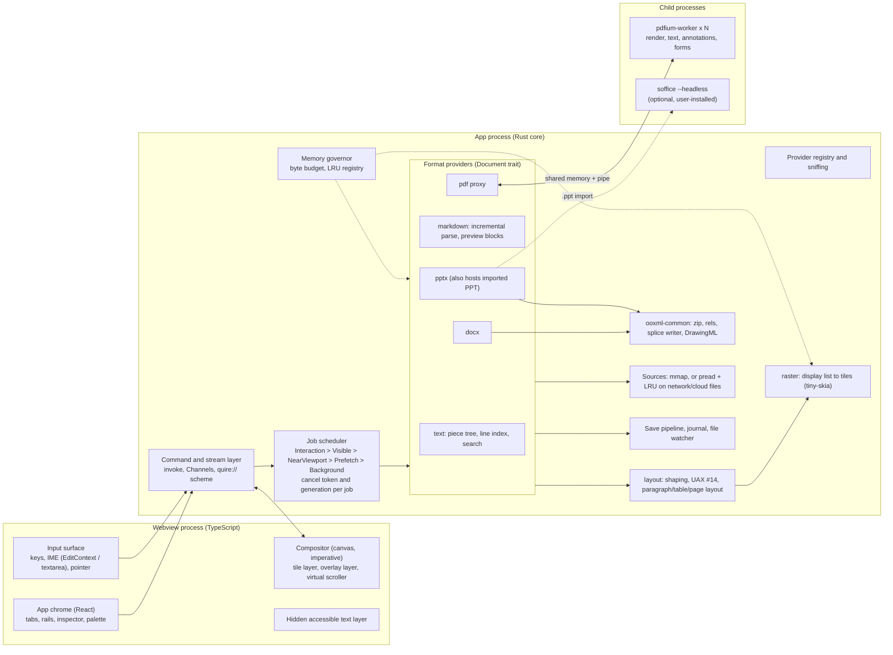
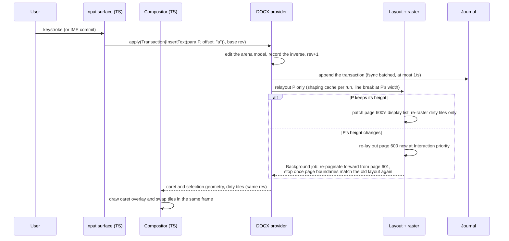

# Architecture (draft, pending plan approval)

quire is a Tauri 2 app. A Rust core owns every document: it parses, lays out, rasterizes, searches, edits and saves. The webview is a thin compositor. It draws tiles the core has already rasterized, draws overlays from geometry the core supplies, and forwards input. The frontend never holds a whole document. Native code that can crash or isn't thread-safe (PDFium, the PPT converter) runs in child processes.

## Components



Every stage caches its output, keyed by (unit, revision, zoom bucket), and every cache registers with the governor. Tiles are 256 or 512 device pixels. On zoom, the compositor scales existing tiles at once and swaps in sharp ones as they arrive. The fallback layer is a low-resolution bitmap per visible unit, so a blank screen is never shown.

## Data flow 1: jump to page 4,000 of a 1 GB PDF

```mermaid
sequenceDiagram
  participant U as User
  participant C as Compositor (TS)
  participant S as Core scheduler
  participant P as PDF provider
  participant W as pdfium-worker k
  U->>C: drag custom scrollbar thumb
  C->>C: map thumb to (page 3999, y offset) using the page-size table<br/>(exact where known, else estimated from known sizes)
  C->>C: draw placeholders now: cached thumbnail if any, else page frame + number
  C->>S: viewport(doc, gen=g+1, pages 3999-4000, zoom bucket, dpr)
  S->>S: bump generation, cancel in-flight jobs from gen g,<br/>drop queued stale jobs, coalesce duplicates
  S->>P: Visible: low-res page bitmaps, then sharp tiles<br/>NearViewport: +-2 pages; Background: text for selection
  P->>W: render(page 3999, tile rect, matrix, cancel id)
  W->>W: FPDF_LoadPage (the worker reads the file through its own<br/>mapping via custom file-access callbacks), FPDF_RenderPageBitmap
  W-->>P: BGRA tile in a shared-memory slot
  P-->>S: tile into the raster cache (counted by the governor)
  S-->>C: tile over the binary transport chosen in ADR-0007
  C->>C: drawImage, replacing the placeholder
```

Budget: a typical page at 100 % in ≤ 150 ms (§4). If a worker crashes, the provider restarts it and re-queues the job, and the user only sees that tile render again.

## Data flow 2: type a character on page 600 of a DOCX



Budget: input to visual response p95 ≤ 16 ms (§4). While pagination converges, the status bar shows an estimated page count ("~1,240 pages").

## Invariants

- No task on the UI thread runs longer than 8 ms. Bulk data never crosses IPC as JSON or base64.
- Saving writes a temp file, fsyncs it, then atomically replaces the original. The mapped-file sequence is in §5.8. Every save produces a save report.
- Content the app doesn't understand is kept byte-for-byte. Spliced XML ranges and raw-copied zip entries are the default write path.
- Every parser returns errors instead of panicking. Panics are caught at the provider boundary, and native code runs in worker processes.
